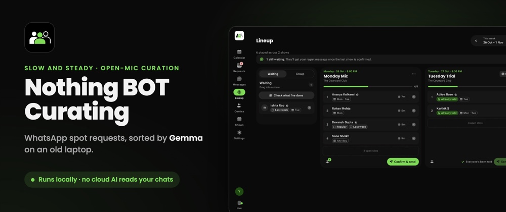
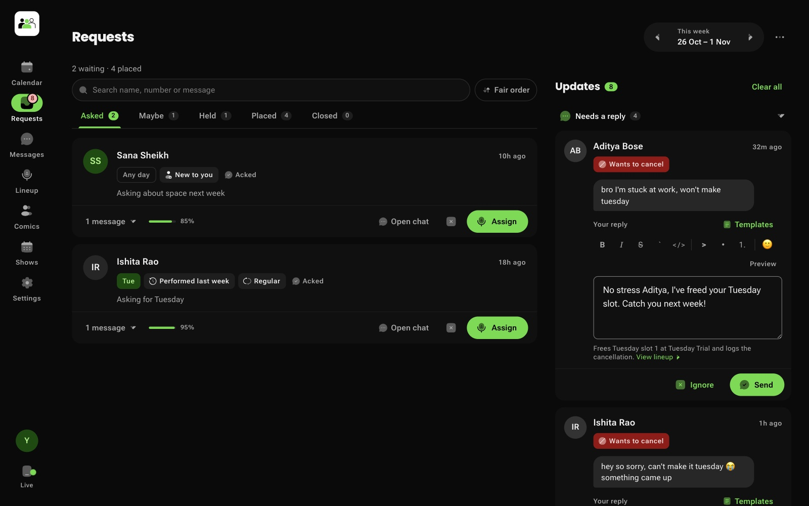
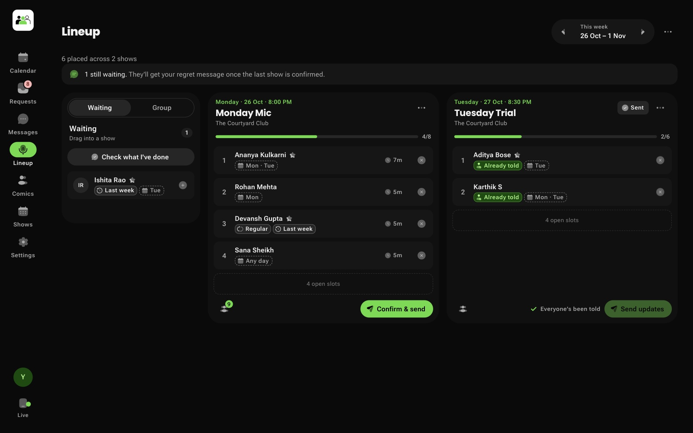
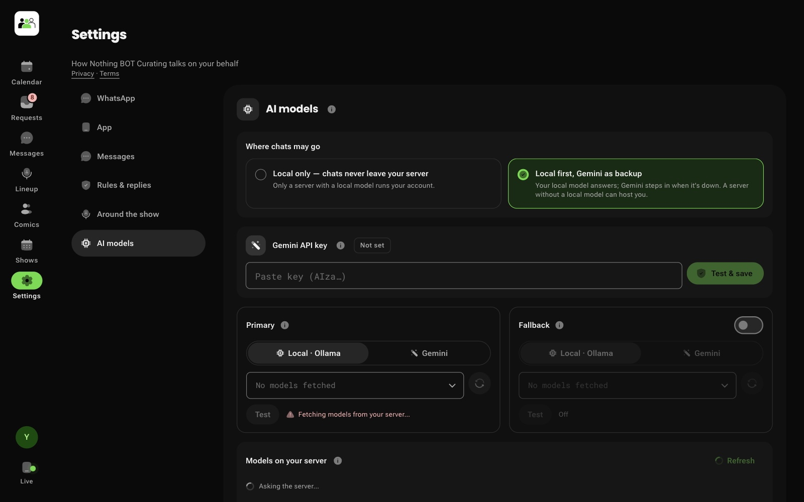
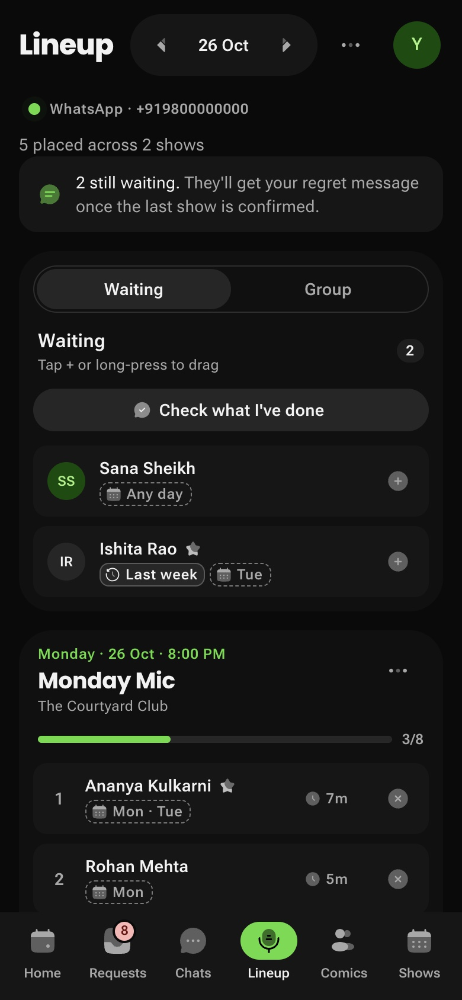
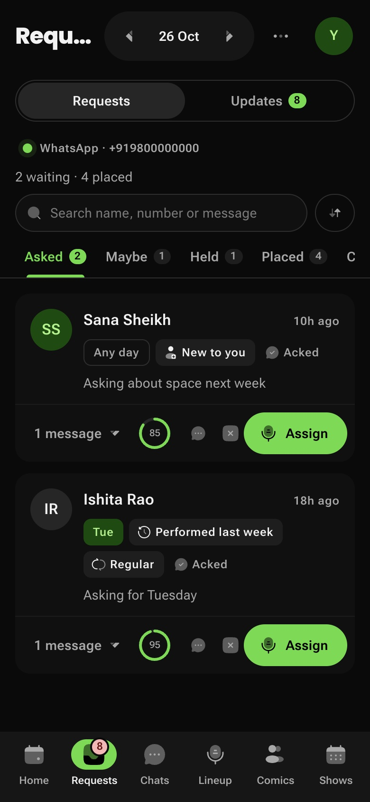
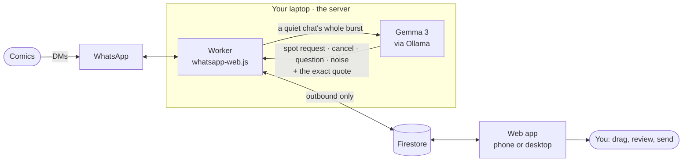
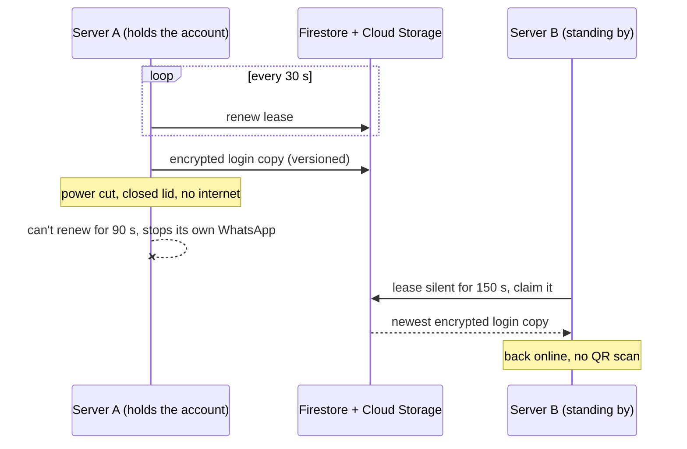

<p align="center">
  
</p>

<p align="center">
  <a href="https://nothingbotcurating.web.app"></a>
  
  
</p>

<p align="center">
  <b>Your open-mic lineup, sorted while you sleep.</b><br/>
  Comics ask for spots in your WhatsApp DMs, however they like. A Gemma model running on your own laptop picks out the real requests.<br/>
  You drag names into shows and press send. Confirmations, polite regrets and show groups take care of themselves.
</p>

<p align="center">
  <a href="https://nothingbotcurating.web.app"><b>Try the live demo</b></a> ·
  <a href="https://nothingbotcomedy.web.app">For comics: Nothing BOT Comedy</a> ·
  <a href="https://dev.to/amrit-dash/my-whatsapp-was-my-open-mic-booking-system-so-i-gave-it-to-gemma-5274">The write-up on DEV</a> ·
  <a href="#run-a-server">Run a server</a> ·
  <a href="docs/README.md">Docs</a>
</p>

---

## Why this exists

I'm a stand-up comic in Bangalore and I curate the Monday and Tuesday open-mic lineups at a club. Spot requests arrive in WhatsApp between family groups, comic gossip, bank alerts and memes. Every new message buries the older ones, so being fair to whoever asked first meant scrolling back through every chat, checking who performed last week, messaging everyone and fixing each show's group by hand.

**That was about 3 hours a week. Now it's about 15 minutes.**

Version 1 ran for 7 months across 2024 and 2025 on Google Apps Script, Sheets and Twilio (2,200+ requests from 150+ comics). Nothing BOT Curating keeps every rule V1 learned and hands the messy human part to an open-weight model that runs on hardware you already own.

## See it

<p align="center"><sub>Try your own demo sandbox at <a href="https://nothingbotcurating.web.app">nothingbotcurating.web.app</a>, no sign-up.</sub></p>

<table>
  <tr>
    <td width="50%"><br/><sub><b>Requests.</b> Gemma's triage, with replies drafted and waiting for your OK in the Updates column.</sub></td>
    <td width="50%"><br/><sub><b>Lineup.</b> Drag from Waiting into shows, or tap + on a phone. Comics already told are marked.</sub></td>
  </tr>
  <tr>
    <td width="50%"><br/><sub><b>Your call.</b> "Local only" keeps every chat on a server running Gemma. Or let Gemini step in as a backup.</sub></td>
    <td width="50%" align="center"> <br/><sub><b>Built for the phone.</b> Installs as an app.</sub></td>
  </tr>
</table>

## How it works



1. **Comics DM you like they always have.** Nothing changes for them.
2. **The worker waits until a chat goes quiet** (45 s), then hands the whole burst to Gemma, so "hey" … "monday?" … "got a new 5" is one request, not three.
3. **Gemma classifies it and has to quote the ask.** The worker checks the quote is really in the messages. If it isn't, it's noise. That one rule is what stops a 4B model from turning an OTP into a spot request.
4. **Requests land on the board.** You drag comics into shows and hit **Confirm & send**.
5. **Confirmations, regrets and group changes go out**, spaced like a human would send them, and only after you review them.

The laptop never opens a port. The web app writes commands to Firestore and the worker picks them up, so it works on home Wi-Fi while you're on mobile data across town. More detail in [docs/architecture.md](docs/architecture.md).

## What it does

<details open>
<summary><b>Triage</b></summary>

- Understands English, Hinglish and Kannada ("bhai monday ka spot milega?", "guru tuesday sigutta?").
- Sorts every conversation into spot request (with preferred days), cancellation, "am I up this week?", "when was my last spot?", venue and timing questions, or noise.
- Chats that aren't spot requests are never stored. A "spot request" has to mention a spot, a day or one of your venues, so a chat about rent or lunch can only ever reach **Maybe**.
- Rules from V1: request windows, skip-last-week, host, ban and ignore lists. Rule-breakers wait in a **Held** tab instead of your inbox.
</details>

<details>
<summary><b>Curation</b></summary>

- Lineup board with drag and drop on desktop and a tap-to-add flow on phones.
- Two looks: **NBC** (black, white and green, the default) or **Classic** marigold, in Settings → Appearance.
- "Performed last week" tags, experience tiers, preferred-day chips and spot history ("last spot 12 days ago").
- **Repeat last week** for weeks after a cancelled mic. **Reset a lineup or the whole week** when plans change.
- "Did the mic happen?" the next morning. "No" undoes the night in everyone's history.
- Spot offers: offer an open slot to one comic. Yes books it, no or silence frees it.
- Hosts poll: a WhatsApp poll of the week's shows, with votes shown on each show.
</details>

<details>
<summary><b>Messages and groups</b></summary>

- **Your voice** (opt-in): Gemma learns how you write from messages *you* sent, then writes each message to a comic that way, a little different for everyone. Your template is the guide and the safety net: a draft that changes a date, time, venue or link is thrown out and the template goes out instead.
- Every message is editable in Settings → Messages: acknowledgements, confirmations, regrets, cancellations, spot offers, "am I up?", "where and when", held-request replies and more.
- Saved replies: your own templates, one tap away on any reply box, with `{{name}}` filled in.
- `{{name}}` is the name you saved them under in your phone, else their WhatsApp name, else "there".
- Templates for acknowledgements, confirmations and regrets with `{{name}}`, `{{show}}`, `{{venue}}`, `{{day}}`, `{{date}}`, `{{time}}`, `{{minutes}}`, `{{mapsLink}}`, and optional sections such as `{{#minutes}}…{{/minutes}}`.
- Group sync: after confirming, review who gets added to and removed from each show's group. Admins, regulars and co-hosts always stay. Or let a show update its group automatically on the day.
- New faces: someone you haven't saved gets a friendly "who are you?" and their answer fills in their profile.
</details>

<details>
<summary><b>Your people</b></summary>

- Import comics from your saved WhatsApp contacts, from a CSV or vCard file (Google Contacts exports work), or from every member of a show's group.
- Search by keyword (commas match any: `comic, open mic`), select all matches, import.
- Mark regulars and co-hosts straight from the group's member list.
- Only clear spot asks join Comics on their own. A Maybe joins when you place it on a lineup.
- Select many comics and remove them in one go, with Undo.
</details>

<details>
<summary><b>Running it</b></summary>

- One installer each for Ubuntu (even from a USB stick), Windows and macOS, plus Docker.
- Survives restarts, power cuts and closed lids, and catches up on DMs that arrived while it was down (without auto-replying to any of them).
- Restart the worker, restart Ollama, read logs and approve curators from the app's **Server** page.
- The server console (port 7420, on the machine and your home network) has **Setup** steps (connect with Google, admins, optional Gemini key), a **Health** card with Check and repair, **Services** with a Stop and Start button for the worker and for Ollama (a stopped Ollama stays stopped across updates), **AI models** (the Gemini key is checked with Google before it is saved, model tests, local model downloads, default routing), and a **Display options** menu (theme, NBC or Classic brand, customize the page).
- Invite-only: other curators sign in, an admin approves them, and they link their own WhatsApp.
- Push notifications for the things you'd want to know: an account moved servers, WhatsApp needs a rescan, a server went quiet.
- Admin tools for cleaning up: delete a curator's data by scope, remove a user, wipe demo sandboxes.
</details>

## Nothing BOT Comedy: the comic's side

The sister app, at [nothingbotcomedy.web.app](https://nothingbotcomedy.web.app) (`apps/comic`), is for the comic *asking* rooms for spots. Same Google account, same server, same WhatsApp link, so a curator who also performs uses both. It is a separate app with its own name and icon.

- **Today and a calendar.** What to ask for today, your spots, and what is coming: a swipeable week strip, a month view and a day panel.
- **Asks.** Each room has its own ask rule (the morning of, the day before, a fixed weekday). The message goes from your own WhatsApp at the right time, either reviewed first (Skip / Edit / Send) or sent on its own. Curators' replies are read and marked Got it, Declined or No reply.
- **My spots.** Booked spots with room, time and curator, plus notes afterwards. **Regular spots** (a weekly or monthly slot) are computed from their rule, can be skipped for a date, and are suggested from your roster.
- **Group spot alerts.** Watched WhatsApp groups are read on your server. Clear offers and closures push instantly with no model call (**rules first**); only doubtful messages go to the model. The alert rules are weighted and editable on the Groups page. **Ask for it** on an alert creates an ask.
- **Rooms and rosters.** Rooms, shows, curators and limits, with paste-anything import (text, CSV or Excel, PDF, image or link) reviewed in plain words before anything is saved. Community rosters let a city share its rooms: browse, follow, see updates, suggest changes, publish.
- **Connection status.** Settings and Today show whether your server and WhatsApp are linked, from the same session data Curating uses.
- **Agent number.** Message your agent number to change rooms, spots, regulars and asks in plain words. It checks with you before anything that matters, unless you turn that off.

## Several laptops, one lineup

Run as many servers as you like against the same project: a Mac, a Windows laptop, an Ubuntu box in a cupboard. Each WhatsApp account runs on exactly one of them at a time.



- **No double replies.** A server that can't renew its lease shuts its own WhatsApp off before anyone else is allowed to take over.
- **No QR scans on failover.** The login is encrypted on the server (AES-256-GCM, one key per account) before it goes to Cloud Storage, and the newest version always wins.
- **Least busy server wins**, and a curator can pin themselves to one. "Local only" accounts only ever land on servers running Gemma. Gemini-only servers handle the rest.
- **One key per device.** Lose a laptop, revoke its key, the others keep going.

The user guide is in [docs/multi-server.md](docs/multi-server.md) and the protocol in [docs/fleet.md](docs/fleet.md).

## Run a server

| Platform | How |
| --- | --- |
| **Ubuntu** (laptop, mini PC, or a USB stick) | `curl -fsSL https://nothingbotcurating.web.app/install.sh \| sudo bash` · [guide](docs/ubuntu-usb-server.md) |
| **Windows 10/11** | PowerShell as Administrator: `irm https://nothingbotcurating.web.app/install.ps1 \| iex`, or download [NothingBotServer-Windows.zip](https://nothingbotcurating.web.app/dl/NothingBotServer-Windows.zip), unzip, double-click **Install Nothing BOT Server.cmd** · [guide](docs/windows-server.md) |
| **macOS** | `curl -fsSL https://nothingbotcurating.web.app/install.sh \| bash` (installs the Nothing BOT Server menu-bar app; `install-mac.sh` at the same address still works) · [guide](docs/mac-server.md) |
| **Docker** | `docker compose -f deploy/docker-compose.yml up -d` |

[nothingbotcurating.web.app/install](https://nothingbotcurating.web.app/install) picks the right one for the computer you're on. Local model or Gemini only is chosen in the server console (**AI models**) and can be switched any time. After installing, click **Connect with Nothing BOT Curating** in the console and sign in with Google (no key files), then open the app, go to **Settings → Show QR code**, and scan it from WhatsApp → Linked devices. Servers update themselves. Installers and updaters also remove an old pre-rename Spot Solutions install on the same machine and keep its data.

> [!IMPORTANT]
> Upgrading from an older release? Stop the old server before the new one links. Servers from before multi-server support don't know about leases, so new servers pause and show a notice while one is online.

## Develop

Requirements: Node 22, pnpm 9, [Ollama](https://ollama.com), and a Firebase project with Firestore and Google sign-in.

```bash
pnpm install
ollama pull gemma3:4b

cp apps/worker/.env.example apps/worker/.env   # service-account key path, admin emails
cp apps/web/.env.example apps/web/.env         # Firebase web config
pnpm dev:worker
pnpm dev:web
```

No Firebase project yet? Both apps run against the local emulators (Java and firebase-tools needed): `pnpm --filter @spot/comic emulators` starts Auth and Firestore with the `demo-nbot` project id, then run the web app with `VITE_USE_EMULATORS=1 VITE_FIREBASE_PROJECT_ID=demo-nbot pnpm dev:web`, or `pnpm --filter @spot/comic dev:emulator` for Comedy. The switch only works in `vite dev`. See [CONTRIBUTING.md](CONTRIBUTING.md).

```bash
pnpm test                       # shared + worker tests
cd apps/web && npx tsc -b       # strict build check
pnpm --filter @spot/worker exec tsx scripts/eval-intent.ts gemma3:4b   # intent fixtures against your local model
```

```
apps/web         Nothing BOT Curating: React + Vite app (Material 3, PWA) on Firebase Hosting
apps/comic       Nothing BOT Comedy: the comic-side app (rooms, asks, spots, group alerts)
apps/worker      Node worker: WhatsApp sessions, Gemma intake, commands, fleet, login vault, and the server console
packages/shared  Types and pure logic shared by the apps and the worker (templates, weeks, rules, rooms, fleet)
packages/ui      App-agnostic UI shared by both apps (components, theme, shell, Firebase init)
functions        Cloud Functions: device linking, Google Contacts, roster lookups
deploy           Installers for Ubuntu, Windows, macOS, Docker, and per-device key scripts
docs             Guides and the fleet protocol
```

See [CONTRIBUTING.md](CONTRIBUTING.md) before opening a pull request.

## Safety and privacy

- **Nothing is sent without your OK.** Confirmations and regrets go out only when you press send.
- **Auto-acknowledge is off by default.** When on, it replies only to a quoted ask at 85%+ confidence, in a message under 10 minutes old, from a real person (never a business account).
- **Your voice reads only what you sent**, keeps a short description and up to 15 examples, and never stores the chats. Off until you turn it on.
- **No cloud model reads your chats** unless you allow Gemini as a backup. "Local only" turns it off entirely.
- Chats from before you linked are only read when you run **Scan past messages** yourself (Requests, ⋯ menu). It runs on your own server, sends nothing to anyone, and saves only the spot requests it finds.
- **Google Contacts is names and phone numbers only, and never deletes.** Press **Keep connected** once and names are saved even when the app is closed. The long-lived Google access is stored **encrypted** (AES-256-GCM, key in Secret Manager) in a document no app user can read, and is revoked and deleted when you press Disconnect (or remove it at myaccount.google.com/permissions). Imports and "Sync all" are always reviewed by you first.
- Security details and how to report a problem: [SECURITY.md](SECURITY.md).

> [!NOTE]
> Nothing BOT Curating uses [whatsapp-web.js](https://wwebjs.dev), an unofficial WhatsApp Web client. It isn't affiliated with WhatsApp, and automated use can get a number restricted. Every send is queued with a 3 to 8 second gap and a typing indicator to keep volume human. Use it at your own risk.

## Credits

- [whatsapp-web.js](https://github.com/pedroslopez/whatsapp-web.js) (Apache-2.0)
- [Gemma](https://ai.google.dev/gemma) by Google, served by [Ollama](https://ollama.com)
- [Solar icons](https://www.figma.com/community/file/1166831539721848736) by 480 Design (CC BY 4.0)
- [Material Color Utilities](https://github.com/material-foundation/material-color-utilities) (Apache-2.0)

Built for the [DEV Hacktoberfest 2026 Open-Source AI Challenge](https://dev.to/challenges/hacktoberfest-week3-2026-10-19) (Week 3: *Slow and Steady*).

MIT © Amrit Dash
