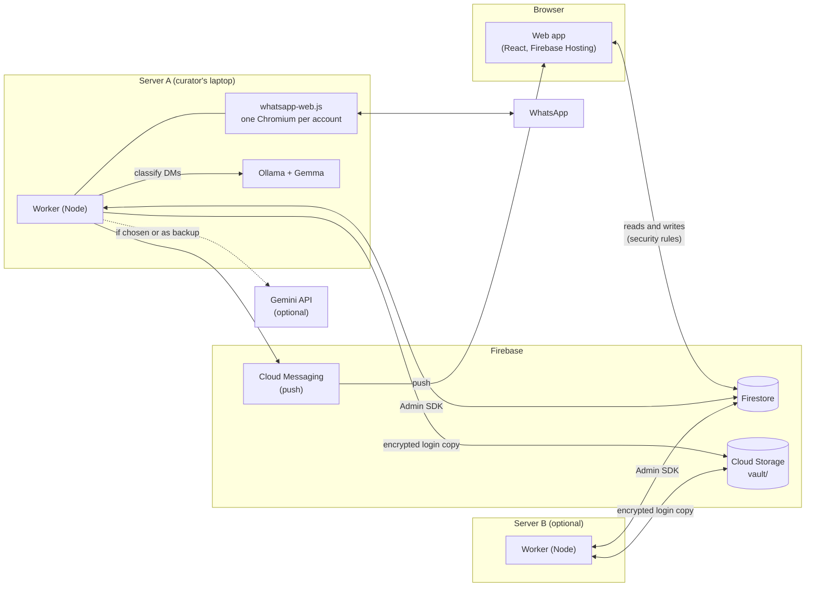
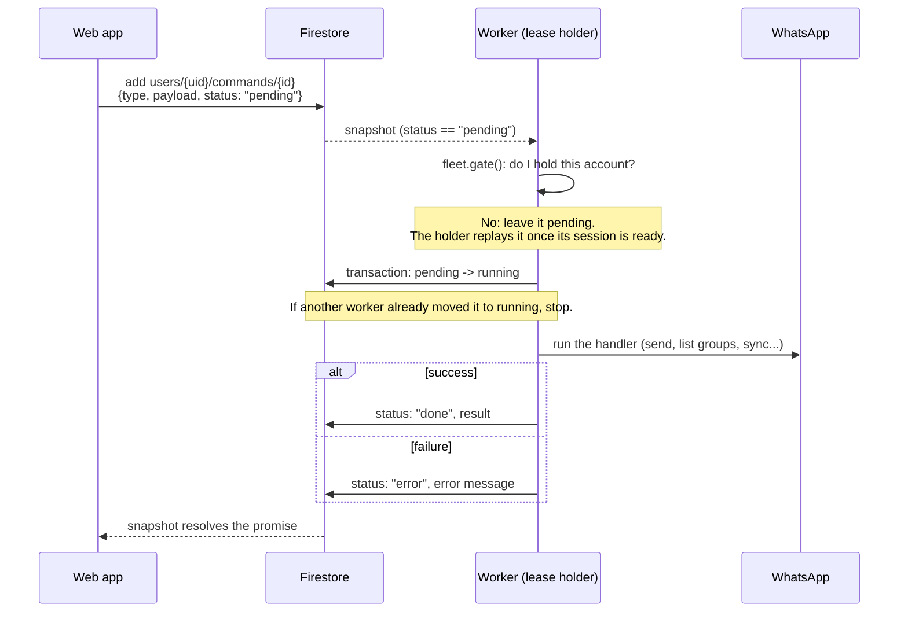
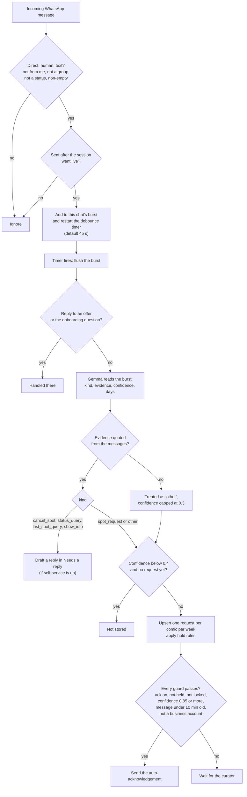

# Architecture

Nothing BOT Curate has three parts: a React web app, Firestore, and one or more workers that run on the curator's own computers. Firestore is the only transport. The web app never talks to a worker directly, and a worker never opens a port.

All outbound. The worker connects to Firestore, Storage, FCM, WhatsApp Web and Ollama (on localhost), and optionally the Gemini API. With two or more servers, each account runs on exactly one of them (see [fleet.md](fleet.md)).

## What each part does

| Part | Job |
| --- | --- |
| Web app | The curator's UI. Reads and writes Firestore directly under the security rules. Anything that needs WhatsApp is a command document. |
| Worker | Keeps each approved curator's WhatsApp session alive, reads incoming DMs, runs commands, sends the messages the curator approves, and heartbeats to `servers/{id}`. |
| Firestore | Data, commands, heartbeats, leases. The single source of truth. |
| Ollama / Gemini | Turn a burst of DMs into an intent. Local Gemma by default, Gemini by choice or as a backup (see "AI routing"). |
| Cloud Storage | Holds only the encrypted WhatsApp login copies. No client can touch it. |

On start the worker listens to `users` and `access`. Only curators whose `access/{uid}` is `approved` (up to `config/access.maxCurators`, oldest approval first) get a command listener. An account that has linked WhatsApp (`waEnabled`) also gets a session, but only on the server that holds its lease.

## Command flow

The web app never calls the worker. It writes a document to `users/{uid}/commands` and waits for the status to change. Types are listed in `CommandType` (`packages/shared/src/types.ts`): `connect`, `logout`, `list_groups`, `send_confirmations`, `send_rejections`, `send_action`, `send_offer`, `send_host_poll`, `list_models`, `list_gemini_models`, `test_ai`, `pull_model`, `plan_group_sync`, `sync_group`, `pull_group_members`, `list_contacts`, `move_account`, `send_message`, `scan_history`.

Details from `apps/worker/src/commands.ts` and `apps/web/src/lib/data.ts`:

- The pending to running step is a Firestore transaction, so two workers never run the same command twice.
- Commands that need a live session throw `WhatsApp isn't connected yet` when the session is not ready.
- The app rejects with "The worker didn't respond" after 10 minutes by default (`runCommand` in `apps/web/src/lib/data.ts`). `move_account` waits 5 minutes.
- The rules only let an approved owner create a command with `status == "pending"` and one of the allowed types. Admins can create only `move_account` for other users, and can read only those.

## Message intake

`apps/worker/src/intake.ts` and `apps/worker/src/gemma.ts`.

**Debounce.** Messages are grouped per chat (`uid|comicId`). Every new message restarts the timer. `settings.debounceSeconds` sets it (default 45). A burst is read as one conversation. Each message body is cut to 1000 characters on intake and 400 when sent to the model.

**Only live messages, unless the curator asks.** Anything older than the moment the session went live (minus 5 seconds) is not read automatically. Older chats are only read when the curator runs **Scan past messages** themselves (`scan_history`, the last 1 to 21 days of 1:1 DMs): it classifies them with the same local Gemma and fills requests, sends nothing, and stores no non-request messages. After a restart, `catchUpSince` reads DMs from the last 3 days (capped at 60 chats) in quiet mode: they can create requests and drafts, but nothing is sent automatically.

**Classification.** `classify()` asks the model for JSON with `evidence`, `kind`, `is_spot_request`, `confidence`, `preferred_days`, `show_hint` and `note`. Kinds: `spot_request`, `cancel_spot`, `status_query`, `last_spot_query`, `show_info`, `other`.

**Quoted-evidence check.** Every kind except `other` needs `evidence`, the exact words that show the ask. `evidenceIsReal()` normalises both sides and accepts the evidence if it appears in the messages, or if at least 75% of its words do. If not, the kind becomes `other` with the note "No actual ask found in the messages". Non-requests get their confidence capped at 0.3. This stops small models from inventing requests out of bank alerts and chat noise.

**Privacy.** A chat with no existing request and confidence under 0.4 (`MAYBE_THRESHOLD`) is never stored. Between 0.4 and 0.6 (`INTENT_THRESHOLD`) a request lands in the "Maybe" lane.

**Hold rules.** `holdFor()` (`packages/shared/src/rules.ts`) can hold a request back, in this order: `banned`, `ignored`, `host` (comic lists), `midweek` (outside the weekly request window), `last_week` (performed last week, if that rule is on). A curator can override a hold.

**Auto-acknowledge.** Off by default (`DEFAULT_SETTINGS.ack.enabled` is false). When on, it needs all of: not a quiet (backlog) burst, no active hold, request not locked, not already acked, a spot request with confidence at least 0.85 (`AUTO_ACK_THRESHOLD`), a message newer than 10 minutes (`AUTO_ACK_MAX_AGE_MS`), and a non-business sender. Outgoing messages go through a per-client queue with a 3 to 8 second jitter (`apps/worker/src/sendQueue.ts`).

### Request statuses

`RequestStatus` in `packages/shared/src/types.ts`.

| Status | Set when |
| --- | --- |
| `new` | The request is created, or a placed comic is taken out of a lineup before any ack. |
| `acked` | The auto-acknowledgement was sent, or a placed comic is taken out of a lineup after an ack. |
| `assigned` | The curator put the comic into a lineup (done in the web app, `apps/web/src/lib/lineup.ts`). |
| `confirmed` | The confirmation message for the lineup was sent (`send_confirmations`). |
| `rejected` | A regret was sent after the week's lineups were final (`send_rejections`). |
| `dismissed` | The curator dismissed it, or the comic dropped out (`cancel_spot`). |

`confirmed`, `dismissed`, `assigned` and `rejected` are locked: later messages from the same comic add to the thread but never change the status.

## AI routing

`apps/worker/src/llm.ts` and `apps/worker/src/aiRouting.ts`. Each curator has a primary route and an optional fallback (`settings.ai`), each either `ollama` or `gemini`. The policy decides which routes may be tried:

- `local_only`: only Ollama routes. Gemini is never called. Only servers with a local model may host the account.
- `local_first` (default): primary, then fallback. If a Gemini key is available and no route uses Gemini, Gemini (`gemini-2.5-flash`) is added last.

Gemini keys are stored write-only in `users/{uid}/secrets/ai`. The worker uses the curator's key, or the server's `GEMINI_API_KEY` if they have none. A server started with `NBS_NO_LOCAL_MODEL=1` skips Ollama entirely.

## Firestore data model

Types are in `packages/shared/src/types.ts` and `packages/shared/src/fleet.ts`. Access is from `firestore.rules`. "Worker" means the Admin SDK, which bypasses the rules.

| Path | Holds | Client access | Written by |
| --- | --- | --- | --- |
| `users/{uid}` | Profile, `settings` (AI, rules, templates, timezone), `waEnabled`, `selfId`, `aiKeys` summary | Owner reads, creates, updates. Owner cannot change `waEnabled`, `selfId`, `agentEnabled` or `demo`. | App, worker |
| `users/{uid}/venues`, `shows`, `comics`, `requests`, `lineups`, `actions`, `notices` | The curator's working data | Owner read and write | App, worker |
| `users/{uid}/session/state` | WhatsApp status, QR, phone, heartbeat | Owner reads | Worker |
| `users/{uid}/session/agent` | The agent number: status, QR, phone, and what it is waiting for you to answer (`pending`), digest and notice cursors ([agent.md](agent.md)) | Owner reads | Worker |
| `users/{uid}/groups`, `contactsImport`, `offers`, `polls` | WhatsApp groups, imported contacts, spot offers, host polls | Owner reads | Worker |
| `users/{uid}/secrets/ai` | The curator's Gemini key | Owner can create, update, delete. Nobody can read it back. | App writes, worker reads |
| `users/{uid}/commands/{id}` | Commands (see above) | Approved owner creates pending commands of allowed types and reads them. Admins read and create `move_account` only. | App creates, worker updates |
| `users/{uid}/fleet/lease` | Which server runs the account: `server`, `epoch`, `state`, `renewedAt`, `moveTo` | Owner and admins read | Servers only |
| `users/{uid}/fleet/vault` | Metadata of the encrypted login copy: `gen`, `savedAt`, `object`, `sha256` | Owner and admins read | Servers only |
| `users/{uid}/fleet/vault_agent` | Same, for the agent number's login | None (servers only) | Servers only |
| `users/{uid}/fleet/prefs` | `pinned`: the server to keep the account on | Owner and admins read and write (only the `pinned` key) | App |
| `users/{uid}/devices/{token}` | Push tokens, one per browser | Owner reads, creates, updates, deletes | App |
| `access/{uid}` | Invite-only access: `pending`, `approved`, `removed` | Owner and admins read. Owner creates a `pending` entry. Admins change `status`, `decidedAt`, `decidedBy`. | App, worker (auto-approves admins) |
| `config/access` | `admins` (emails) and `maxCurators` | Signed-in, non-anonymous users read. Admins change `maxCurators` (1 to 100). | Worker writes `admins` from `NBS_ADMIN_EMAILS` |
| `servers/{id}` | Full heartbeat: health, Ollama, sessions, logs, admin emails, `fleet` capacity | Admins listed in that doc read | Server |
| `servers/{id}/commands/{id}` | Admin actions: `restart_worker`, `restart_ollama`, `delete_user_data`, `remove_user`, `wipe_demo` | That server's admins read and create | Admin creates, server updates |
| `fleetServers/{id}` | Public summary of a server: hostname, platform, capacity (no logs or emails) | Approved curators and admins read | Server |
| `vaultKeys/{uid}`, `vaultKeys/{uid}_agent` | The AES-256 login key of the account and of its agent number | None. `allow read, write: if false`. | Servers only |
| `users/demo-curator/...` | Read-only demo template (venues, shows, comics, requests, lineups, actions, notices) | Any signed-in user reads | Seed script |

Cloud Storage holds one thing: `vault/{uid}/login-{gen}-{nonce}.bin` (and `vault/{uid}_agent/…` for the agent number), the AES-256-GCM encrypted login (Chromium `IndexedDB` and `Local Storage`). `storage.rules` denies every client read and write. `VaultMeta.object` names the committed object. Older and uncommitted objects are deleted after 10 minutes.

## Messages (live reads, nothing stored on a server)

The Messages page reads chats on demand through three commands: `list_threads` (roster comics only, newest first, 80-character snippet, unread, "their message is waiting"), `get_thread` (about 50 messages, older pages with `before`) and `summarize_thread` (a sentence, a suggested reply and actions whose evidence quotes are checked against the chat; it never sends or applies anything). Sending uses the existing `send_message`, with an optional `voice` flag that rewrites plain text through `inVoice`. Their results are the only place chat text exists in Firestore: the app deletes the command document as soon as it has read it (`runCommand(..., { ephemeral: true })`), and the document carries `expireAt` (`TTL_DAYS.messages`) as a backstop. Rules let the owner create these commands, read them and delete only these types. `list_voice_sources` (names of every chat for the "Your voice" picker) follows the same rule. Pure rules (mapping, snippets, paging, day separators) are `packages/shared/src/threads.ts`; the model prompt and evidence check are `apps/worker/src/threadAssist.ts`. `get_media` returns one sticker (data URL, max 150 KB, only for chats that can be opened here) as an equally short-lived result. "Needs reply" counts a reaction from you as an answer: `list_threads` reads the last few messages of the newest chats that end with theirs and checks reactions on those (bounded). Group writers and tags arrive as @lid; the worker maps them to phones (`chatNames.ts`: Comics, the show's member cache, contact name, then +number) and `get_thread` returns the group's members for the composer's @ picker; `send_message` tags can name any member. The demo builds sample chats from its own requests.

## Pictures in messages (sending, and viewing on demand)

**Sending.** Any message can carry one picture: the chat composer (one-to-one and group; the image button, or Photo under +), a template (Settings → Messages), a scheduled group post, an offer and a reply. The app squeezes the pick to a JPEG (1600 px longest side, quality 0.8, at most 4 MB; a phone offers the camera or the library, `accept="image/*"`), uploads it to Firebase Storage in the curator's own folder and passes only the path: `send_image` ({ comicId | groupId, path, caption, name }) for a chat, or `image: { path, name }` on a message (`RichMessage.image`, so every sender that goes through `sendRich` sends it, with the text as the caption, through the same queue and jitter). Storage paths, all under `users/{uid}/`:

- `outbox/{id}.jpg`: a picture sent once. Written and read by the owner only (`storage.rules`: signed-in non-demo, a picture of at most 4 MB). The server deletes it right after the send (an offer to several comics: after the last), a failed send keeps it so Retry works, the app deletes it when the curator discards the message, and the server's sweep deletes any left over after 6 hours.
- `attachments/{id}.jpg`: a picture kept on a message that is sent again and again (a template, a scheduled group post: a post repeats every week, so there is no "last send"). It stays while a template or post points at it; the server deletes one nothing uses for 24 hours (`imagePathsInUse`, which looks across every template, every show's posts and after-show message). The app never deletes a kept picture itself, so a post copied from another show (which copies the `image` path) shares the file safely: it goes only when no post or template refers to it any more.
- `media-cache/{messageId}`: see below. Written by the server only; the owner can read and delete it.

The server only trusts a path that is exactly one of the account's own upload paths (`parseImagePath`), because a path in a settings document could otherwise name someone else's file. It checks the stored size and type before sending (`sendImageProblem`). `apps/worker/src/media.ts` holds all of it behind a small store interface; `packages/shared/src/media.ts` holds the pure rules; the app side is `apps/web/src/lib/pictures.ts` and `components/ImageAttach.tsx`.

**Viewing is on demand.** Reading a chat downloads no media. A photo or sticker (incoming or outgoing) is a placeholder: image icon, "Photo", the caption, the size when WhatsApp says, and a View button. Tapping View sends `fetch_media` ({ comicId | groupId, messageId }); the server (only for chats that can be opened: roster comics and linked groups, never Never read) calls `downloadMedia()` on that one message, writes it to `users/{uid}/media-cache/{messageId}` and answers with the path (`FetchMediaResult`). The app reads the file, shows it in a full-screen viewer (pinch, double-tap, drag) and deletes the cache file when the chat is closed; the server deletes any cache file after one hour. Failures are said in words: expired or deleted on WhatsApp, too big (over 16 MB, answered without downloading when WhatsApp gives the size), not a picture, and "your server is offline" when the worker doesn't answer. Videos, voice notes and documents are not fetched ("Open on your phone").

**Privacy.** A fetched picture is held for at most an hour and only because the curator asked for that one message; chats that are not requests are never stored beyond that, and no picture or caption is written to Firestore (the command carries a path, and its result is deleted by the app as soon as it is read, `expireAt` as the backstop). The worker logs counts, never content. Pictures the curator sends are their own content, deleted after sending (templates and scheduled posts keep theirs because they are part of the message). Neither folder can be read by anyone but the owner and the server.

## Data retention

Short-lived documents carry an `expireAt` Timestamp and Firestore TTL deletes them: `commands` (7 days, both `users/{uid}/commands` and `servers/{id}/commands`), `notices` (30 days), `contactsImport` (1 day) and `invites` (30 days). Set the policies once with `deploy/setup-cost-controls.sh`, then stamp existing documents with `apps/worker/scripts/backfill-expire-at.ts`. The same script turns off Cloud Storage soft delete on the bucket.

The worker also runs a daily job (`apps/worker/src/retention.ts`). Each server deletes old requests for the accounts it holds: dismissed, rejected and confirmed requests whose week is older than `settings.retention.closedRequestsWeeks` (default 8, 0 keeps them forever). Lineups and comics are never deleted. One server a day (a date lock in `config/demoCleanup`) deletes demo sandboxes older than 7 days. The heartbeat in `servers/{id}` sends the worker log only while an admin has the Server page's log open (`logsWanted`).

## Fleet in one paragraph

Any number of servers share one Firebase project. Each approved account has a lease at `users/{uid}/fleet/lease`. The holder renews it every 30 seconds, and another server may claim it after 150 seconds without a renewal. The login moves between servers as an encrypted copy in Cloud Storage, so a takeover needs no new QR scan. The full protocol (lease, fencing, moves, vault, old-server guard) is in [fleet.md](fleet.md). The user-facing guide is [multi-server.md](multi-server.md).

## Monorepo layout

| Path | What it is |
| --- | --- |
| `apps/web` | Nothing BOT Curate: React 19 + Vite + Tailwind PWA, deployed to Firebase Hosting. |
| `apps/comic` | Nothing BOT Comedy, the comic-side PWA (rooms, asks, my spots, regular spots, group spot alerts, community rosters). Same Firebase project and servers as Curate; its data is owner-only collections under `users/{uid}` plus `publishedRosters`. |
| `packages/ui` | App-agnostic UI shared by both apps: components, theme (NBC and Classic), shell, Firebase init (with the `VITE_USE_EMULATORS` switch). |
| `functions` | Cloud Functions: join codes and device links, Google Contacts, roster lookups. |
| `apps/worker` | The Node worker: WhatsApp sessions, intake, commands, fleet, vault. Also `console/` (the local server console on port 7420) and `scripts/` (demo seed, intent eval). |
| `packages/shared` | Types, defaults, rules, week maths and fleet rules used by both the app and the worker. Plain TypeScript, no build step. |
| `deploy` | Installers (`install.sh`, `windows/`, `mac/`), per-device key scripts, `build-dist.sh`, Docker files. |
| `docs` | These docs. |

Root files: `firestore.rules`, `storage.rules`, `firestore.indexes.json` and `firebase.json` define the Firebase side. `pnpm deploy:web` builds Curate, adds the installers and a source tarball to the build (`deploy/build-dist.sh`, which also writes the redirect-only page for the retired spot-solutions.web.app), and deploys the Curate hosting sites, Firestore rules and Storage rules. `pnpm deploy:comic` deploys Nothing BOT Comedy.

### Messages: on-device cache, actions, photos (chat screens v2)

- **Cache.** The list and each chat's last 40 messages are kept in this browser only (IndexedDB `spot-chats`, per uid, 30 chats max, `apps/web/src/lib/chatCache.ts`), shown at once, then synced (every 60 s / 30 s while visible, on open, on the header sync button, pull-to-refresh). Cleared at sign-out. Never written to Firestore. "Done / Needs reply" flags are a chat id plus a time in localStorage (`chatMarks.ts`); no text.
- **Not synced yet.** While what is on screen is a saved copy, or the last read failed or is older than 150 s, a banner says so and send / react / photo / Done / Never read ask first (in-page dialog; it goes ahead by itself if the sync finishes while it is open). Rules: `packages/shared/src/chatState.ts`.
- **Commands.** `send_message` takes `comicId` / `groupId` and sends to the chat id WhatsApp itself lists (Never read refused). `react_message` (`msg.react`, empty emoji removes) and `send_media` (one JPEG, at most about 600 KB after the app squeezes it to 1600 px, in the command document that the app deletes as soon as it is done). `get_media` (a photo or sticker inline, loaded as it scrolled into view) is no longer used by the app: photos are now View-on-demand through `fetch_media` and Storage (see Pictures in messages); the command stays only so an older app still works, and `send_media` likewise (the app now sends `send_image`).
- **Phone layout.** An open chat is a full-screen layer (portal) sized to the visual viewport, so the message list is the only scroller and the composer rides the keyboard. Desktop keeps the two panes.
- **AI budget.** Messages summary and drafts use an interactive budget (`aiBudget.ts`): local model 150 s, Gemini 60 s, 240 s for the whole job including queue wait, the app waits 300 s. A local timeout falls through to Gemini when the AI policy allows it; the thread sent to the model is capped (30 messages / 6000 characters); the command document's `stage` shows progress.
