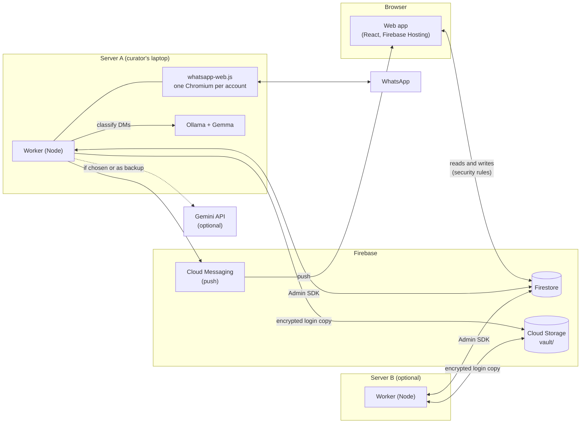
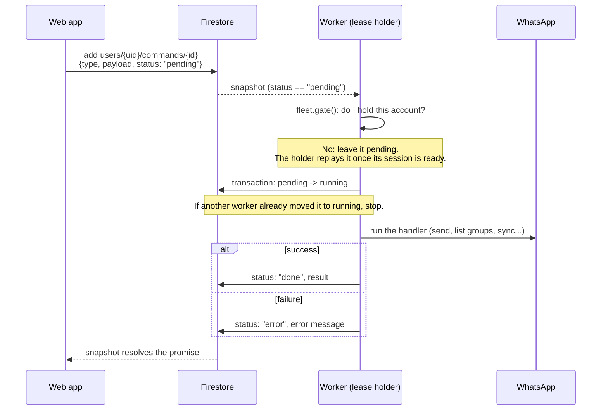
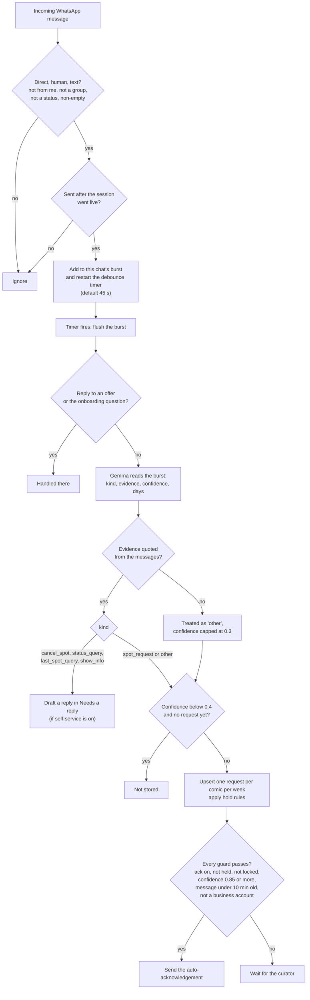

# Architecture

Spot Solutions has three parts: a React web app, Firestore, and one or more workers that run on the curator's own computers. Firestore is the only transport. The web app never talks to a worker directly, and a worker never opens a port.

All outbound. The worker connects to Firestore, Storage, FCM, WhatsApp Web and Ollama (on localhost), and optionally the Gemini API. With two or more servers, each account runs on exactly one of them (see [fleet.md](fleet.md)).

## What each part does

| Part | Job |
| --- | --- |
| Web app | The curator's UI. Reads and writes Firestore directly under the security rules. Anything that needs WhatsApp is a command document. |
| Worker | Keeps each approved curator's WhatsApp session alive, reads incoming DMs, runs commands, sends the messages the curator approves, and heartbeats to `servers/{id}`. |
| Firestore | Data, commands, heartbeats, leases. The single source of truth. |
| Ollama / Gemini | Turn a burst of DMs into an intent. Local Gemma by default, Gemini by choice or as a backup (see "AI routing"). |
| Cloud Storage | Holds only the encrypted WhatsApp login copies. No client can touch it. |

On start the worker listens to `users` and `access`. Only curators whose `access/{uid}` is `approved` (up to `config/access.maxCurators`, oldest approval first) get a command listener. An account that has linked WhatsApp (`waEnabled`) also gets a session, but only on the server that holds its lease.

## Command flow

The web app never calls the worker. It writes a document to `users/{uid}/commands` and waits for the status to change. Types are listed in `CommandType` (`packages/shared/src/types.ts`): `connect`, `logout`, `list_groups`, `send_confirmations`, `send_rejections`, `send_action`, `send_offer`, `send_host_poll`, `list_models`, `list_gemini_models`, `test_ai`, `pull_model`, `plan_group_sync`, `sync_group`, `pull_group_members`, `list_contacts`, `move_account`, `send_message`.

Details from `apps/worker/src/commands.ts` and `apps/web/src/lib/data.ts`:

- The pending to running step is a Firestore transaction, so two workers never run the same command twice.
- Commands that need a live session throw `WhatsApp isn't connected yet` when the session is not ready.
- The app rejects with "The worker didn't respond" after 10 minutes by default (`runCommand` in `apps/web/src/lib/data.ts`). `move_account` waits 5 minutes.
- The rules only let an approved owner create a command with `status == "pending"` and one of the allowed types. Admins can create only `move_account` for other users, and can read only those.

## Message intake

`apps/worker/src/intake.ts` and `apps/worker/src/gemma.ts`.

**Debounce.** Messages are grouped per chat (`uid|comicId`). Every new message restarts the timer. `settings.debounceSeconds` sets it (default 45). A burst is read as one conversation. Each message body is cut to 1000 characters on intake and 400 when sent to the model.

**Only live messages.** Anything older than the moment the session went live (minus 5 seconds) is never read. After a restart, `catchUpSince` reads DMs from the last 3 days (capped at 60 chats) in quiet mode: they can create requests and drafts, but nothing is sent automatically.

**Classification.** `classify()` asks the model for JSON with `evidence`, `kind`, `is_spot_request`, `confidence`, `preferred_days`, `show_hint` and `note`. Kinds: `spot_request`, `cancel_spot`, `status_query`, `last_spot_query`, `show_info`, `other`.

**Quoted-evidence check.** Every kind except `other` needs `evidence`, the exact words that show the ask. `evidenceIsReal()` normalises both sides and accepts the evidence if it appears in the messages, or if at least 75% of its words do. If not, the kind becomes `other` with the note "No actual ask found in the messages". Non-requests get their confidence capped at 0.3. This stops small models from inventing requests out of bank alerts and chat noise.

**Privacy.** A chat with no existing request and confidence under 0.4 (`MAYBE_THRESHOLD`) is never stored. Between 0.4 and 0.6 (`INTENT_THRESHOLD`) a request lands in the "Maybe" lane.

**Hold rules.** `holdFor()` (`packages/shared/src/rules.ts`) can hold a request back, in this order: `banned`, `ignored`, `host` (comic lists), `midweek` (outside the weekly request window), `last_week` (performed last week, if that rule is on). A curator can override a hold.

**Auto-acknowledge.** Off by default (`DEFAULT_SETTINGS.ack.enabled` is false). When on, it needs all of: not a quiet (backlog) burst, no active hold, request not locked, not already acked, a spot request with confidence at least 0.85 (`AUTO_ACK_THRESHOLD`), a message newer than 10 minutes (`AUTO_ACK_MAX_AGE_MS`), and a non-business sender. Outgoing messages go through a per-client queue with a 3 to 8 second jitter (`apps/worker/src/sendQueue.ts`).

### Request statuses

`RequestStatus` in `packages/shared/src/types.ts`.

| Status | Set when |
| --- | --- |
| `new` | The request is created, or a placed comic is taken out of a lineup before any ack. |
| `acked` | The auto-acknowledgement was sent, or a placed comic is taken out of a lineup after an ack. |
| `assigned` | The curator put the comic into a lineup (done in the web app, `apps/web/src/lib/lineup.ts`). |
| `confirmed` | The confirmation message for the lineup was sent (`send_confirmations`). |
| `rejected` | A regret was sent after the week's lineups were final (`send_rejections`). |
| `dismissed` | The curator dismissed it, or the comic dropped out (`cancel_spot`). |

`confirmed`, `dismissed`, `assigned` and `rejected` are locked: later messages from the same comic add to the thread but never change the status.

## AI routing

`apps/worker/src/llm.ts` and `apps/worker/src/aiRouting.ts`. Each curator has a primary route and an optional fallback (`settings.ai`), each either `ollama` or `gemini`. The policy decides which routes may be tried:

- `local_only`: only Ollama routes. Gemini is never called. Only servers with a local model may host the account.
- `local_first` (default): primary, then fallback. If a Gemini key is available and no route uses Gemini, Gemini (`gemini-2.5-flash`) is added last.

Gemini keys are stored write-only in `users/{uid}/secrets/ai`. The worker uses the curator's key, or the server's `GEMINI_API_KEY` if they have none. A server started with `SPOT_NO_LOCAL_MODEL=1` skips Ollama entirely.

## Firestore data model

Types are in `packages/shared/src/types.ts` and `packages/shared/src/fleet.ts`. Access is from `firestore.rules`. "Worker" means the Admin SDK, which bypasses the rules.

| Path | Holds | Client access | Written by |
| --- | --- | --- | --- |
| `users/{uid}` | Profile, `settings` (AI, rules, templates, timezone), `waEnabled`, `selfId`, `aiKeys` summary | Owner reads, creates, updates. Owner cannot change `waEnabled`, `selfId` or `demo`. | App, worker |
| `users/{uid}/venues`, `shows`, `comics`, `requests`, `lineups`, `actions`, `notices` | The curator's working data | Owner read and write | App, worker |
| `users/{uid}/session/state` | WhatsApp status, QR, phone, heartbeat | Owner reads | Worker |
| `users/{uid}/groups`, `contactsImport`, `offers`, `polls` | WhatsApp groups, imported contacts, spot offers, host polls | Owner reads | Worker |
| `users/{uid}/secrets/ai` | The curator's Gemini key | Owner can create, update, delete. Nobody can read it back. | App writes, worker reads |
| `users/{uid}/commands/{id}` | Commands (see above) | Approved owner creates pending commands of allowed types and reads them. Admins read and create `move_account` only. | App creates, worker updates |
| `users/{uid}/fleet/lease` | Which server runs the account: `server`, `epoch`, `state`, `renewedAt`, `moveTo` | Owner and admins read | Servers only |
| `users/{uid}/fleet/vault` | Metadata of the encrypted login copy: `gen`, `savedAt`, `object`, `sha256` | Owner and admins read | Servers only |
| `users/{uid}/fleet/prefs` | `pinned`: the server to keep the account on | Owner and admins read and write (only the `pinned` key) | App |
| `users/{uid}/devices/{token}` | Push tokens, one per browser | Owner reads, creates, updates, deletes | App |
| `access/{uid}` | Invite-only access: `pending`, `approved`, `removed` | Owner and admins read. Owner creates a `pending` entry. Admins change `status`, `decidedAt`, `decidedBy`. | App, worker (auto-approves admins) |
| `config/access` | `admins` (emails) and `maxCurators` | Signed-in, non-anonymous users read. Admins change `maxCurators` (1 to 100). | Worker writes `admins` from `SPOT_ADMIN_EMAILS` |
| `servers/{id}` | Full heartbeat: health, Ollama, sessions, logs, admin emails, `fleet` capacity | Admins listed in that doc read | Server |
| `servers/{id}/commands/{id}` | Admin actions: `restart_worker`, `restart_ollama`, `delete_user_data`, `remove_user`, `wipe_demo` | That server's admins read and create | Admin creates, server updates |
| `fleetServers/{id}` | Public summary of a server: hostname, platform, capacity (no logs or emails) | Approved curators and admins read | Server |
| `vaultKeys/{uid}` | The account's AES-256 login key | None. `allow read, write: if false`. | Servers only |
| `users/demo-curator/...` | Read-only demo template (venues, shows, comics, requests, lineups, actions, notices) | Any signed-in user reads | Seed script |

Cloud Storage holds one thing: `vault/{uid}/login-{gen}-{nonce}.bin`, the AES-256-GCM encrypted login (Chromium `IndexedDB` and `Local Storage`). `storage.rules` denies every client read and write. `VaultMeta.object` names the committed object. Older and uncommitted objects are deleted after 10 minutes.

## Fleet in one paragraph

Any number of servers share one Firebase project. Each approved account has a lease at `users/{uid}/fleet/lease`. The holder renews it every 30 seconds, and another server may claim it after 150 seconds without a renewal. The login moves between servers as an encrypted copy in Cloud Storage, so a takeover needs no new QR scan. The full protocol (lease, fencing, moves, vault, old-server guard) is in [fleet.md](fleet.md). The user-facing guide is [multi-server.md](multi-server.md).

## Monorepo layout

| Path | What it is |
| --- | --- |
| `apps/web` | React 19 + Vite + Tailwind PWA, deployed to Firebase Hosting. |
| `apps/worker` | The Node worker: WhatsApp sessions, intake, commands, fleet, vault. Also `console/` (the local server console on port 7420) and `scripts/` (demo seed, intent eval). |
| `packages/shared` | Types, defaults, rules, week maths and fleet rules used by both the app and the worker. Plain TypeScript, no build step. |
| `deploy` | Installers (`install.sh`, `windows/`, `mac/`), per-device key scripts, `build-dist.sh`, Docker files. |
| `docs` | These docs. |

Root files: `firestore.rules`, `storage.rules`, `firestore.indexes.json` and `firebase.json` define the Firebase side. `pnpm deploy:web` builds the app, adds the installers and a source tarball to the build (`deploy/build-dist.sh`), and deploys hosting, Firestore rules and Storage rules.
